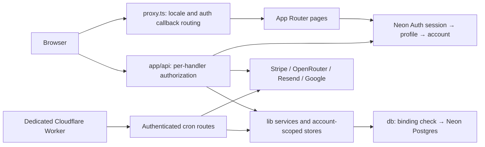

# AISO architecture

AISO is a multi-tenant Next.js 16 application for website AEO/GEO scans, AI
visibility monitoring (Pulse), and evidence-backed remediation. This is the
navigation map; [CLAUDE.md](CLAUDE.md) holds detailed implementation rules and
[development.md](docs/development.md) contains runnable checks and release steps.

## Boundaries and data flow

- **UI:** `app/[lang]/` serves `en` and `zh-HK`; `app/admin/` is unlocalized.
  `proxy.ts` handles locale routing and auth verifier callbacks. Its matcher
  skips APIs and `/admin`; it is not the application authorization gate.
- **Identity:** `lib/neon-auth.ts` lazily constructs the SDK; `lib/auth.ts`
  resolves the session into a non-deactivated profile and its account.
  Layouts protect their page subtrees; each API must separately authorize its
  request, directly or through a service. Neon user webhooks provision accounts
  through `app/api/webhooks/neon/route.ts::provisionAccountForUser`.
- **Persistence:** `lib/db.ts` lazily creates a tagged-template SQL client and
  verifies project/branch/role/database expectations against the connection.
  Queries must still scope by the session's `account_id`; the binding guard
  does not provide tenant isolation. RLS is not a fallback. SQL migrations and
  their ledger live under the legacy `supabase/migrations/` name; Supabase
  clients and dependencies have been removed.
- **Entitlements:** `lib/tier.ts::resolveCommercialEntitlement` resolves status,
  trial expiry and overrides. A plan name alone is insufficient authorization.
- **Hosting:** Next.js runs on Vercel (`sin1`, explicit function budgets in
  `vercel.json`). The scheduler is a separate Cloudflare deployment, using
  `cloudflare/aiso-worker/wrangler.jsonc` and shared source in `cloudflare/cron-worker/`.
  Repository config and old evidence files do not prove current live state.

## Core journeys and executable evidence

| Journey | Implementation and invariants | Focused tests |
| --- | --- | --- |
| Public scan → result | `app/api/scan/route.ts`, `lib/checks/`, `lib/scoring.ts`; guarded outbound fetches, anonymous rate limits, explicit partial/unassessed results | `__tests__/api/scan-security.test.ts`, `__tests__/api/scan-flow.test.ts`, `__tests__/api/scan.test.ts` |
| Result → sign-in → claim | `app/api/scans/[id]/{claim-intent,claim}/`; signed 15-minute intent, single-use attempt consumed before account assignment, conditional update of unowned scan | `__tests__/api/scan-claim-recovery.test.ts`, `__tests__/api/scan-claim.test.ts`, `__tests__/integration/scan-claim-attempt.test.ts` |
| Onboarding → brand workspace | `app/api/onboarding/complete/`, `lib/onboarding/`; session account, persisted progress and retry/resume | `__tests__/api/onboarding-flow.test.ts`, `__tests__/integration/onboarding-resume.test.ts` |
| Checkout → subscription → entitlement | `app/api/stripe/{checkout,webhook}/`; verified signature, canonical Stripe retrieval under subscription lease, atomic event ledger/account update, stale and duplicate handling | `__tests__/api/stripe-webhook-full.test.ts`, `__tests__/api/stripe-entitlement-integrity.test.ts`, `__tests__/integration/stripe-webhook-lifecycle.test.ts` |
| Scheduled Pulse → alerts | `app/api/cron/`, `app/api/pulse/run/`, `lib/pulse/`, `lib/alerts/`; durable attempts, saved-raw repair, rollups and delivery ledgers | `__tests__/api/pulse-run.test.ts`, `__tests__/api/cron/evaluate-alerts.test.ts`, `cloudflare/cron-worker/test/scheduled.test.ts` |
| Evidence → remediation → approval → outcome | `lib/observations/`, `lib/work-items/`, `lib/change-sets/`, `lib/delivery/`, `lib/outcomes/`; account-scoped immutable evidence and explicit decisions | `__tests__/work-items/service.test.ts`, exact-target suites listed in `scripts/ci/run-exact-target-suites.mjs` |

The new claim recovery tests compose real route handlers, signing and attempt
consumption with a stateful SQL boundary fake. They prove orchestration and
responses, not Postgres locking. The integration suites exercise actual SQL.
Billing boundary tests mock Stripe and SQL; they do not prove provider delivery.

## Short risk map

| Risk | Impact / existing control | Remaining evidence or gap |
| --- | --- | --- |
| Build validation compatibility | High: production compilation/type validation is a release gate | Local webpack build rejects existing helper exports in four route modules; default Turbopack build is unverified here due to an internal port permission error. See [reproduction](docs/development.md#observed-build-validation-gap) |
| Cross-account access | High: explicit session account filters and composite foreign keys | New queries can omit scope; extend owned-success/foreign-denial integration coverage when stores change |
| Lost or repeated billing updates | High: canonical retrieval, expiring lease, atomic apply/ledger; non-2xx on unconfirmed writes | Provider configuration, price mappings and live delivery require release validation |
| Public funnel outage or unsafe fetch | High: rate-limit and claim secrets, guarded fetch, single-use intents | Build success does not validate runtime secrets or external DNS; failed claim writes consume the intent, so recovery needs a fresh one |
| Monitoring gaps / repeated delivery | High: durable Pulse attempts and alert ledgers; dedicated scheduler config | Enabled schedules, overlapping producers and end-to-end completion need live readback; trial email send-before-ledger can resend after a write failure |
| False confidence from test layers | Medium: CI aggregates six job classes and rejects missing evidence | Fixture tests do not establish hosted Auth, real providers or actual scheduled completion; integration needs a proven disposable target |

## Next three engineering investments

1. **Close the build/release verification gap.** Move reusable helpers out of
   Next.js route exports into ordinary library modules, and verify the production
   build from a clean checkout. Then automate a read-only release receipt tying
   app SHA, DB migration/binding identity and Worker schedules to the target.
   Acceptance: supported build/type checks pass and every release dependency is
   verified, failed or unknown, without exposing secrets.
2. **Expand tenant-isolation integration contracts.** Apply the existing
   owned-success/foreign-denial pattern to every store and route family; inventory
   omissions in CI. Acceptance: each data surface proves read and write denial
   for a second account using real SQL, including disabled memberships.
3. **Close asynchronous recovery gaps.** Add an outbox/idempotent delivery design
   for trial email and correlated completion alerts for Pulse/alert producers.
   Acceptance: injected provider/ledger failures and duplicate dispatches cannot
   silently lose a job or resend a committed message; unknown outcomes remain
   visible for reconciliation.
